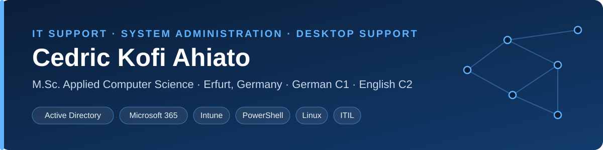
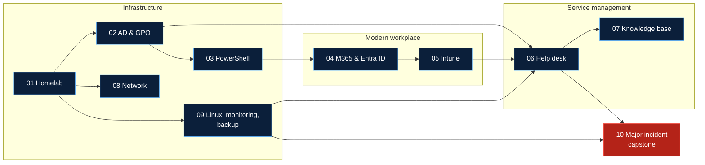

  
  <!-- TODO: add your LinkedIn:  -->
  
  

## About me

IT professional with an **M.Sc. in Applied Computer Science** and hands-on experience in **1st and 2nd-level support** and **system administration**: Active Directory, Windows and Linux servers, VMware and Hyper-V, DNS, with tickets tracked in Jira. I'm currently training as an **IT Support Specialist (IHK)**.

This GitHub is my lab portfolio. In it I build and document the IT of a small fictional company, *NordLicht Handel GmbH* (25 staff), end to end: from the first domain controller to a major incident review.

> [!NOTE]
> **Kurzfassung (DE):** IT-Fachkraft (M.Sc. Angewandte Informatik) mit Erfahrung im 1st-/2nd-Level-Support und in der Systemadministration. Hier dokumentiere ich praxisnahe Laborprojekte zu Active Directory, Microsoft 365, Intune, PowerShell, Netzwerk, Linux und IT-Service-Management. Deutsch C1 · Englisch C2 · verfügbar ab sofort.

## Portfolio: 10 projects, one company

| | Project | What it shows | Stack |
|:-:|---|---|---|
| **01** | [**Homelab Build**](https://github.com/BigDougCed/01-homelab-build) | Hyper-V lab: Windows Server 2022 DC (AD DS, DNS, DHCP), Windows 11 clients, Ubuntu, built by script | Hyper-V · PowerShell |
| **02** | [**Active Directory & Group Policy**](https://github.com/BigDougCed/02-active-directory-gpo) | OU design, AGDLP permissions, file shares, 8 documented GPOs | AD · GPO · NTFS |
| **03** | [**PowerShell AD Automation**](https://github.com/BigDougCed/03-powershell-ad-automation) | Onboarding/offboarding from HR CSV, help desk password reset, AD hygiene report, Pester tests + CI | PowerShell · Pester |
| **04** | [**Microsoft 365 & Entra ID**](https://github.com/BigDougCed/04-m365-entra-id) | Group-based licensing, MFA, Conditional Access baseline, Exchange Online, Graph scripts | Entra ID · Graph |
| **05** | [**Intune Endpoint Management**](https://github.com/BigDougCed/05-intune-endpoint-management) | Compliance, BitLocker, update rings, Win32 app packaging, remediations, Autopilot | Intune · Autopilot |
| **06** | [**Help Desk Ticketing**](https://github.com/BigDougCed/06-helpdesk-ticketing-zammad) | Zammad with SLAs P1–P4 and **15 fully documented tickets** (DE/EN communication) | Zammad · ITIL |
| **07** | [**IT Knowledge Base**](https://github.com/BigDougCed/07-it-knowledge-base) | 7 German end-user guides, 3 English technician runbooks | Technical writing |
| **08** | [**Network Lab**](https://github.com/BigDougCed/08-network-lab-packet-tracer) | VLANs, inter-VLAN routing, DHCP, NAT, ACLs, port security, troubleshooting scenarios | Cisco IOS |
| **09** | [**Linux, Monitoring & Backup**](https://github.com/BigDougCed/09-linux-monitoring-backup) | Server hardening, Uptime Kuma alerting, restic 3-2-1 backups with restore tests | Ubuntu · Bash · Docker |
| **10** | [**Major Incident Capstone**](https://github.com/BigDougCed/10-major-incident-capstone) | P1 outage with two root causes: timeline, status updates, post-incident review | ITIL · AD · Kerberos |

## Skills

**Service desk & ITSM** 
    

**Microsoft** 
       

**Infrastructure** 
       

**Scripting, data & cloud** 
      

## Experience at a glance

| Period | Role | Where |
|---|---|---|
| 2026 – 2027 | IT Support Specialist (IHK), training | Syntax Institut GmbH |
| 2024 – 2025 | Student event coordinator, IT user support | Hochschule Schmalkalden |
| 2020 – 2025 | M.Sc. Applied Computer Science | Hochschule Schmalkalden |
| 2017 – 2018 | System Administrator (1st/2nd level, AD, Windows/Linux servers, VMware) | Inpath Technologies, Accra |
| 2015 – 2017 | Tech Support | National Service Secretariat, Accra |

**Languages:** German C1 · English C2

---

All lab projects use a fictional company and contain no real customer data.

